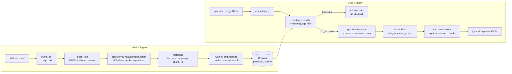

# Tax & Legal Document Q&A

A bilingual (**Arabic + English**) Retrieval-Augmented Generation API that answers questions
over tax and legal PDFs and returns **grounded answers with `[file, page]` citations**, a
confidence level, and an explicit *"I don't know based on the provided documents"* when the
answer isn't in the sources.

Built with **FastAPI**, **LangChain**, **Gemini** (`langchain-google-genai`) and **Chroma**.

---

## The problem

Tax and legal teams work with long regulations, often in more than one language. Generic
chatbots answer from their training data, which may be outdated or simply wrong for a given
jurisdiction, and they don't say *where* an answer comes from. For professional advice
that's unacceptable: every statement must be traceable to a specific page of a specific
document, and the system must refuse when the documents don't cover the question.

This project answers only from the documents you give it, cites the page for every claim,
and validates those citations in code instead of trusting the model.

## Architecture



```
app/
├── main.py            # app factory, logging, global error handlers (429/500)
├── api/routes.py      # /health, /ingest, /query + upload validation
├── core/config.py     # pydantic-settings, all tunables from .env
├── core/logging.py    # logging setup + API-key redaction filter
├── schemas.py         # request/response + LLM structured-output models
└── rag/
    ├── ingest.py      # PDF -> clean text -> chunks + metadata (pure functions)
    ├── embeddings.py  # batching + tenacity retries around any Embeddings
    ├── store.py       # index / replace chunks in Chroma
    ├── retriever.py   # similarity search with metadata filters
    ├── chain.py       # prompt, structured output, citation validation
    └── providers.py   # builds Gemini LLM / embeddings / Chroma (mockable)
tests/                 # 50 tests, fake LLM + fake embeddings, no API key needed
data/                  # two fictional sample regulations (EN + AR)
scripts/               # regenerates the sample PDFs
```

## Quick start (local)

Requires Python 3.11+ and a free Gemini API key from
[Google AI Studio](https://aistudio.google.com/apikey).

```bash
python -m venv .venv
source .venv/bin/activate          # Windows: .venv\Scripts\activate
pip install -e ".[dev]"
cp .env.example .env               # then set GOOGLE_API_KEY in .env
uvicorn app.main:app --reload
```

Open **http://localhost:8000/docs** for the interactive Swagger UI, then:

```bash
curl -X POST http://localhost:8000/ingest                       # index data/
curl -X POST http://localhost:8000/ingest -F "file=@my_law.pdf"  # add one PDF
curl -X POST http://localhost:8000/query -H "Content-Type: application/json" \
     -d '{"question": "What is the standard VAT rate?"}'
```

## Run with Docker

```bash
cp .env.example .env   # set GOOGLE_API_KEY
docker compose up --build
curl -X POST http://localhost:8000/ingest
```

The Chroma index lives in a named volume (`chroma_data`), so it survives restarts, and
`./data` is mounted so you can drop in new PDFs and re-ingest. The API key is read from
`.env` at runtime and is never baked into the image.

## Run the tests

```bash
pytest          # 50 tests, no API key or network needed
ruff check .
```

The LLM and embeddings are replaced by fakes in `tests/conftest.py`. An optional live
test (`test_live_gemini_refuses_unanswerable_question`) runs only when `GOOGLE_API_KEY`
is set.

## API

| Method | Path      | Description |
|--------|-----------|-------------|
| GET    | `/health` | Liveness, configured models, number of indexed chunks |
| POST   | `/ingest` | No body: re-index all PDFs in `data/`. Multipart `file`: add one PDF (`.pdf`, valid `%PDF-` header, ≤ `MAX_UPLOAD_MB`) |
| POST   | `/query`  | `{question, top_k?, file_filter?, language_filter?}` → structured answer |

Error codes: **400** bad file / empty folder / no extractable text, **413** upload too
large, **422** invalid request body, **429** Gemini still rate-limiting after retries,
**500** missing API key (clear message) or unexpected error (generic message; details
are only in the server log).

### Example: English

These examples were captured from a live run (2026-10-24, `gemini-3.8-flash` +
`gemini-embedding-001`) over the sample documents. Wording can vary slightly between runs.

```http
POST /query
{"question": "What is the penalty for late payment of VAT?", "top_k": 4}
```
```json
{
  "answer": "The penalty for late payment is 5 percent of the unpaid tax for each month or part of a month of delay [vat_regulation_en.pdf, 2].",
  "citations": [
    {
      "file": "vat_regulation_en.pdf",
      "page": 2,
      "snippet": "Late payment: 5 percent of the unpaid tax for each month or part of a month of delay."
    }
  ],
  "confidence": "high",
  "retrieved_chunks_count": 4
}
```

### Example: Arabic

```http
POST /query
{"question": "ما هي نسبة ضريبة الاستقطاع على الإتاوات المدفوعة لغير المقيم؟", "language_filter": "ar"}
```
```json
{
  "answer": "نسبة ضريبة الاستقطاع على الإتاوات المدفوعة لغير المقيم هي 15 بالمئة [income_tax_regulation_ar.pdf, 1].",
  "citations": [
    {
      "file": "income_tax_regulation_ar.pdf",
      "page": 1,
      "snippet": "يجب على كل مقيم يدفع مبالغ إلى غير مقيم أن يستقطع الضريبة بالنسب الآتية: 5 بالمئة على أرباح الأسهم، و15 بالمئة على الإتاوات"
    }
  ],
  "confidence": "high",
  "retrieved_chunks_count": 2
}
```

### Example: cross-language (English question, Arabic source)

```json
{"question": "What withholding tax rate applies to management fees paid to non-residents?"}
→ {"answer": "A withholding tax rate of 20 percent applies to management fees paid by a resident to a non-resident [income_tax_regulation_ar.pdf, 1].",
   "citations": [{"file": "income_tax_regulation_ar.pdf", "page": 1,
                  "snippet": "... و15 بالمئة على الإتاوات، و20 بالمئة على أتعاب الإدارة."}],
   "confidence": "high", "retrieved_chunks_count": 4}
```

The reverse works too: an Arabic question about the VAT registration threshold was
answered in Arabic from the English regulation.

### Example: not in the documents

```json
{"question": "What is the corporate tax rate in Japan?"}
→ {"answer": "I don't know based on the provided documents.", "citations": [],
   "confidence": "low", "retrieved_chunks_count": 4}
```

## Design decisions

**Chunk size: 800 characters, 150 overlap, measured in characters.**
Arabic is dense: one character carries more meaning than in English, and one legal
article is often 200–400 characters. In the sample Arabic regulation, three full articles
fit in about 750 characters. 800 characters keeps one or two complete articles per chunk:
big enough to hold a rule *and* its exceptions, small enough that retrieval stays precise
and citations point at one page. The 150-character overlap keeps a sentence that crosses
a chunk boundary readable in both chunks. Chunking is done per page, so a citation's page
number is always exact.

**Arabic-aware separators.** The splitter tries paragraph → line → sentence → clause, using
the Arabic question mark `؟`, semicolon `؛` and comma `،` alongside the Latin ones, so
Arabic text is never cut mid-sentence when a better boundary exists.

**Text cleaning for Arabic PDFs.** PDFs often store Arabic as *presentation forms*
(contextual glyphs such as `ﻻ`). NFKC normalisation maps them back to standard letters.
Tatweel (`ـ`) and diacritics (tashkeel) are removed so that `الضَّرِيبَة` and `الضريبة`
embed identically. Text is extracted in content-stream order: PyMuPDF's `sort=True`
orders spans left to right, which **reverses word order in Arabic lines**. There is a
regression test for this.

**Why Gemini embeddings (`gemini-embedding-001`).** It's a multilingual model trained on
100+ languages, including Arabic, so Arabic and English text share one vector space. An
English question can retrieve an Arabic article and the reverse. It also supports
task types: documents are embedded as `RETRIEVAL_DOCUMENT` and questions as
`RETRIEVAL_QUERY`, which improves question-to-passage matching. The model name is set in
`.env` (`EMBEDDING_MODEL`), so you can switch to `gemini-embedding-2-preview` later. If
you change it, re-run `/ingest`, because vectors from different models aren't comparable.

**Free-tier friendly ingestion.** Embedding calls go out in batches of `EMBED_BATCH_SIZE`.
Each batch is retried with exponential backoff and jitter (tenacity) on 429/5xx errors,
so a rate limit only repeats one batch. The library wraps Google errors, so the retry
check walks the exception's `__cause__` chain to find the real HTTP status. Chunk ids are
deterministic (`file-p{page}-c{n}`), so re-ingesting a file overwrites its chunks instead
of duplicating them.

**Grounding is enforced in three layers, not just the prompt.**
1. *Prompt:* answer only from the `<source>` blocks, cite `[file, page]`, otherwise return
   the exact "I don't know" sentence, and answer in the question's language.
2. *Structured output:* `with_structured_output(AnswerOutput)` makes Gemini return
   JSON matching the Pydantic schema, which is then validated.
3. *Post-validation in code:* citations pointing at a file/page that wasn't retrieved
   are dropped, an answer with no valid citations is downgraded to `low` confidence, and
   when retrieval finds nothing the LLM isn't called at all.

**Why there is no similarity-score threshold.** In the live run, the unanswerable
questions scored about as high as the answerable ones: 0.61 for "corporate tax in Japan"
vs 0.61 for a real question, and 0.73 for an Arabic question about an inheritance tax
the documents don't contain. Cosine similarity measures *topic* overlap ("tax", "rate"),
not whether the passage contains the answer. A fixed cut-off would either block good
questions or let bad ones through, so the decision to refuse is left to the grounded
prompt and checked by tests.

**Prompt-injection guard.** Retrieved text is wrapped in `<source>` tags and the system
prompt declares it untrusted data. `<` and `>` in document text are escaped, so a
malicious PDF can't close the tag and pose as instructions.

**Secrets.** The key lives only in `.env` (git-ignored; `.env.example` is committed). It is
held as a Pydantic `SecretStr` (prints as `**********`), and a logging filter removes the
key and anything shaped like a Google API key from every log record.

**Testability.** All external clients are built in `providers.py` and injected with
FastAPI `Depends` as *factories*. FastAPI resolves dependencies before it validates the
request body, so a bad request still gets a clean 422 rather than a missing-key 500.
Tests swap in a bag-of-words fake embedder and a fake grounded LLM through
`app.dependency_overrides`.

**Sync endpoints.** LangChain/Gemini calls here are blocking, so the endpoints are plain
`def`. FastAPI runs them in a thread pool, which keeps the event loop free.

## Limitations

- **Scanned PDFs aren't supported.** Pages without a text layer are skipped with a warning,
  and an upload that is entirely scanned returns 400.
- Tables and multi-column layouts lose some structure in plain-text extraction.
- Pure vector search can miss exact terms such as article numbers or defined terms;
  there is no keyword (BM25) or hybrid search yet.
- Confidence is the model's self-assessment, capped by code. It isn't a calibrated
  probability.
- No authentication, rate limiting or multi-tenant separation on the API.
- Local Chroma is single-node and fits a demo or a small team, not firm-wide scale.
- Language detection is a simple Arabic-vs-Latin character ratio (two languages only).
- When answering across languages the model translates. In the live run it rendered the
  currency code "EXD" as "دينار إكسامبلي", a name the document never uses. Citations
  keep the original-language snippet so a reviewer can check the source wording.
- The sample documents are **fictional** and must not be used as tax advice.

## Next steps

- **Azure AI Search** as the vector store: hybrid (BM25 + vector) search, semantic
  ranking, security filters per client/matter, managed scaling.
- **Azure AI Document Intelligence** for OCR and layout extraction on scanned PDFs,
  tables and Arabic forms, keeping page numbers for citations.
- **Evaluation:** a fixed set of questions with expected answers and source pages in
  both languages, scored for retrieval hit rate / MRR, citation accuracy, faithfulness
  and correct refusals (e.g. with RAGAS or LLM-as-judge), run in CI to catch regressions
  when chunk size, prompt or model change.
- Re-ranking (cross-encoder) of the top-k chunks before generation.
- Streaming responses, auth (Entra ID), and an audit log of question → sources → answer.

---

*Sample documents in `data/` are fictional and generated by `scripts/make_sample_pdfs.py`.*
